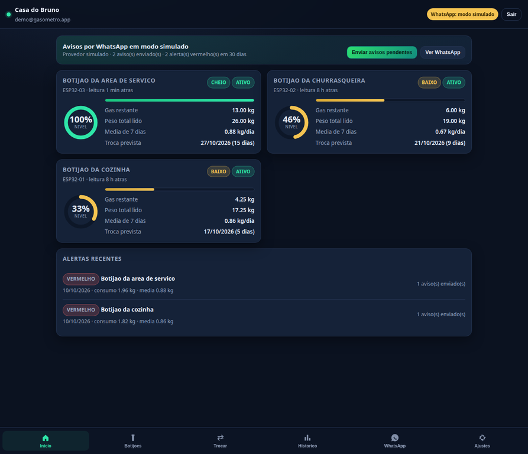

# Gasômetro — medição de gás com aviso no WhatsApp

App executável para acompanhar o **nível de gás do botijão** (medido por célula de carga/ESP32),
a **previsão de troca** e receber **aviso no WhatsApp** quando o consumo foge do padrão.

Ele é a implementação do guia `gasometro_guia_app_e_banco.pdf` (schema v2 corrigido), com as fases
0 a 8 do roteiro cumpridas, mais o canal **WhatsApp** que o guia deixava em aberto na Fase 6.

| Camada | O que foi feito |
|---|---|
| Banco (MySQL 8) | `db/schema_v2.sql` (do guia, verbatim) + `db/patch_v3_whatsapp.sql` (canal WhatsApp e trilha de envio) |
| API | Node.js + Express: login, nível, previsão, consumo, trocas, alertas, canais e ingestão do ESP32 |
| App | PWA instalável (HTML/CSS/JS, sem build): telas Início, Botijões, Trocar, Histórico, WhatsApp e Ajustes |
| Aviso | Worker que varre alertas pendentes e envia pelo WhatsApp (Meta Cloud API, Twilio ou modo simulado) |
| Hardware | `scripts/simulador_esp32.js` faz o papel do ESP32 enquanto a placa não chega |



---

## 1. Como rodar (4 comandos)

Precisa de **MySQL 8.0.19+** e **Node.js 18+**.

```bash
npm install          # dependências
npm run db:criar     # cria o banco gas, aplica o schema v2 + patch do WhatsApp e cria o usuário da API
npm run seed         # local, usuário demo, 3 medidores (botijões P13) e o canal de WhatsApp
npm start            # app + API em http://localhost:3000
```

Abra `http://localhost:3000` e entre com **demo@gasometro.app / gasometro123**.

> Ajuste o `.env` (copiado de `.env.example`): senha do banco, segredo do JWT e o provedor de WhatsApp.

### Com Docker (roda em qualquer máquina)

```bash
docker compose up --build
# app em http://localhost:3000  (o banco sobe junto, já com schema, patch e dados de exemplo)
```

---

## 2. Verificações já executadas

**Fase 2 — validação do banco (script do guia):**

```bash
npm run db:testar
```

Resultado real obtido:

| Teste | Esperado pelo guia | Obtido |
|---|---|---|
| 1. Consumo de ontem | M1 2,50 · M2 1,70 · M3 0,00 · M4 1,50 · M5 NULL | igual |
| 2. Alertas | exatamente M1 VERMELHO e M2 AMARELO | igual |
| 3. Rodar de novo não duplica | continua 2 alertas | igual |
| 4. Nível atual | 73%, 79%, 54%, 96%, 85% — todos CHEIO | igual |
| 5. Média e previsão | 1,21 · 1,10 · 0,00 · 1,07 · sem média | igual |
| 6. Integridade | 4 comandos recusados | recusados (1062, 1062, 3819, 1452) |

**Fase 8 — ponta a ponta pela API (14 checagens):**

```bash
npm run demo
```

Cobre: saúde da API, login (e senha errada recusada), simulação de 14 dias de leituras, nível,
previsão, alertas, envio do aviso, reenvio que não duplica, troca de botijão, recusa de peso absurdo,
histórico, relatório mensal e isolamento entre locais. Resultado: **todas as checagens passam**.

**Fase 3 — ESP32:**

```bash
node scripts/simulador_esp32.js --medidor ESP32-01 --token <token> --loop --intervalo 5
```

Recusa de peso acima de capacidade + tara + margem (500 kg → HTTP 422), token de dispositivo
inválido (HTTP 401) e medidor sem leitura por mais de 2 h virando `OFFLINE` pelo evento horário
do banco: todos verificados.

---

## 3. O app

| Tela | O que mostra | Origem no banco |
|---|---|---|
| **Início** | nível, status, previsão de troca e alertas recentes | `vw_previsao_troca`, `tb_alertas` |
| **Botijões** | lista dos medidores com apelido, nível e situação (ATIVO/INATIVO/OFFLINE) | `vw_nivel_atual`, `tb_medidores` |
| **Trocar** | registra a troca do botijão; nível e previsão se recalculam sozinhos | `INSERT tb_trocas_botijao` |
| **Histórico** | consumo por dia (gráfico), alertas, trocas e consumo por mês | `tb_consumo_diario`, `tb_alertas`, `tb_trocas_botijao` |
| **WhatsApp** | canais, envio de teste, fila de pendentes e avisos enviados | `tb_canais_notificacao`, `tb_notificacoes_enviadas` |
| **Ajustes** | dispositivos/tokens do ESP32, regras em vigor e ferramentas de demonstração | `tb_medidores`, procedures |

Capturas: [`docs/capturas/`](docs/capturas/).

O app é um **PWA**: no celular, "Adicionar à tela de início" instala como aplicativo.
Ele nunca fala com o MySQL — só com a API (a senha do banco não vai para o cliente).

---

## 4. API

Todas as rotas exigem `Authorization: Bearer <token>` (menos login, saúde e ingestão do ESP32).

| Método e rota | Para que serve | Origem no banco |
|---|---|---|
| `POST /api/auth/login` | login (senha em hash bcrypt) | `tb_usuarios` |
| `GET /api/medidores/nivel` | nível atual de cada medidor | `vw_nivel_atual` |
| `GET /api/medidores/:id/previsao` | dias e data estimada de troca | `vw_previsao_troca` |
| `GET /api/medidores/:id/consumo?de=&ate=` | consumo diário | `tb_consumo_diario` |
| `GET/POST /api/medidores/:id/trocas` | histórico e registro de trocas | `tb_trocas_botijao` |
| `GET /api/alertas` · `/api/alertas/resumo` | alertas e contadores | `tb_alertas` |
| `GET/POST/PATCH/DELETE /api/canais` | canais de aviso (WhatsApp etc.) | `tb_canais_notificacao` |
| `POST /api/canais/:id/teste` | mensagem de teste no WhatsApp | — |
| `GET /api/notificacoes` · `/pendentes` · `POST /processar` | trilha, fila e disparo manual | `tb_notificacoes_enviadas` |
| `POST /api/leituras` | **ESP32** envia o peso lido | `tb_leituras` |
| `GET /api/dispositivos` · `POST /api/dispositivos/:id/token` | identificadores e tokens do firmware | `tb_medidores` |
| `GET /api/medidores/relatorios/consumo-mensal` | consumo por mês (base do OLAP) | `tb_consumo_diario` |
| `GET /api/saude` | estado do banco, do canal e das regras | — |

Exemplo de leitura vinda do ESP32:

```bash
curl -X POST http://localhost:3000/api/leituras \
  -H 'Content-Type: application/json' \
  -H 'X-Device-Token: <token do medidor>' \
  -d '{"identificador_esp32":"ESP32-01","peso_total_kg":24.50}'
```

---

## 5. Aviso pelo WhatsApp

O banco gera os alertas (evento diário às 00:10). Quem avisa é o **worker** da API: a cada
`NOTIF_INTERVALO_SEG` (60 s) ele procura alertas sem notificação no canal, envia e registra em
`tb_notificacoes_enviadas`. A chave única `(alerta_id, canal_id)` garante que o mesmo aviso nunca
chega duas vezes; se o provedor falhar, o envio vai para `tb_whatsapp_fila` e é retentado até
`NOTIF_MAX_TENTATIVAS`.

Mensagem enviada (exemplo real gerado pelo app):

```
🔴 *Gasometro - ALERTA VERMELHO*

Medidor: Botijao da cozinha
Consumo em 10/10/2026: *2.09 kg*
Media de 7 dias: 0.91 kg (2.3x)
Nivel atual: 33% (4.25 kg)
Troca prevista: 17/10/2026

Confira o consumo na aba Historico do app.
```

### Modos de envio

| `WHATSAPP_PROVIDER` | O que faz | O que preencher no `.env` |
|---|---|---|
| `simulado` (padrão) | **não envia de verdade**: registra o aviso e gera um link `wa.me` pronto para abrir | nada |
| `meta` | WhatsApp Cloud API (Meta), envio automático | `META_PHONE_NUMBER_ID`, `META_TOKEN` (e `META_TEMPLATE` se usar template aprovado) |
| `twilio` | Twilio WhatsApp API | `TWILIO_ACCOUNT_SID`, `TWILIO_AUTH_TOKEN`, `TWILIO_WHATSAPP_FROM` |

Para ligar o envio real: crie o app no Meta Business (WhatsApp Cloud API), cadastre o número
remetente, gere um token permanente e cole no `.env`. Fora da janela de 24 h o WhatsApp exige
**template aprovado** — informe o nome em `META_TEMPLATE`. No modo `simulado`, cada aviso fica
registrado com um link `wa.me` para conferir o texto exato que sairia.

---

## 6. Regras e limites (as suposições do guia, agora explícitas)

| Suposição do guia | Valor usado | Onde está |
|---|---|---|
| Limites do status do botijão | CHEIO ≥ 50%, BAIXO 15–49%, CRÍTICO < 15% | `vw_nivel_atual` + `LIMITE_*_PCT` no `.env` |
| Tempo sem leitura para OFFLINE | 2 horas | `HORAS_OFFLINE` + evento `ev_verificar_medidores_offline` |
| Histórico mínimo para alerta | 3 dias na janela de 7 | `sp_gerar_alertas` |
| `capacidade_botijao_kg` | kg de gás, sem a tara (P13 = 13,00) | cadastro do medidor |
| Processamento diário | 00:10 (Brasília, `time_zone = -03:00`) | evento `ev_processar_consumo_diario` |
| Validação de peso absurdo | teto = capacidade + tara + `MARGEM_LEITURA_KG` (0,5 kg) | `src/routes/leituras.js` |
| Protocolo do ESP32 | HTTP `POST /api/leituras` com token; intervalo padrão 300 s | `tb_medidores.intervalo_envio_seg` |

---

## 7. Estrutura

```
app-gasometro/
├── db/
│   ├── schema_v2.sql           # do guia (tabelas, views, 4 procedures, 2 eventos)
│   ├── teste_schema_v2.sql     # do guia (5 casos de borda + integridade)
│   └── patch_v3_whatsapp.sql   # canal WHATSAPP, trilha de envio, fila de reenvio, tokens
├── src/
│   ├── server.js               # Express, rotas, erro padrão e subida do worker
│   ├── config.js               # .env + regras de negócio num lugar só
│   ├── db.js · auth.js         # pool MySQL e sessão JWT/bcrypt
│   ├── routes/                 # auth, medidores, alertas, canais, notificacoes, leituras, demo
│   └── services/
│       ├── whatsapp.js         # Meta, Twilio e modo simulado + texto da mensagem
│       └── notificacoes.js     # worker: pendentes, envio e reenvio
├── public/                     # PWA: index.html, app.js, styles.css, sw.js, ícones
├── scripts/
│   ├── setup_db.sh · testar_db.sh   # npm run db:criar / db:testar
│   ├── seed.js                      # npm run seed
│   ├── simulador_esp32.js           # npm run simulador
│   └── demo_e2e.js                  # npm run demo
├── docs/arquitetura.md · docs/capturas/
├── Dockerfile · docker-compose.yml
└── .env.example
```

---

## 8. Decisões em aberto do guia: resolvidas

| Decisão | Escolha feita |
|---|---|
| Stack do app | PWA (HTML/CSS/JS) servida pela própria API — roda no navegador e instala no celular, sem build nem loja |
| Protocolo e intervalo do ESP32 | HTTP `POST /api/leituras` com `X-Device-Token`, intervalos por medidor (`intervalo_envio_seg`) |
| Limites de status / tempo de OFFLINE | 50% / 15% e 2 h (no `.env` e no banco) |
| Canais da primeira versão | WhatsApp como canal principal; SMS, e-mail e push ficam aceitos pelo mesmo modelo |
| Onde o banco e a API rodam | local (ou `docker compose up`); em produção, MySQL gerenciado + a API em um servidor pequeno |

## 9. Próximos passos sugeridos

1. Ligar o envio real do WhatsApp (`WHATSAPP_PROVIDER=meta` + credenciais) e aprovar o template.
2. Em produção, desligar as rotas de demonstração (`DEMO_MODE=false`) e trocar `JWT_SECRET`.
3. Cadastrar o medidor real: gravar o token no firmware e calibrar (`POST /api/calibracoes`).
4. Rodar o ETL do OLAP depois das 00:10 (modelo revisado na seção 6 do guia).
5. Trocar a senha do usuário de demonstração e criar o cadastro de usuários por tela.