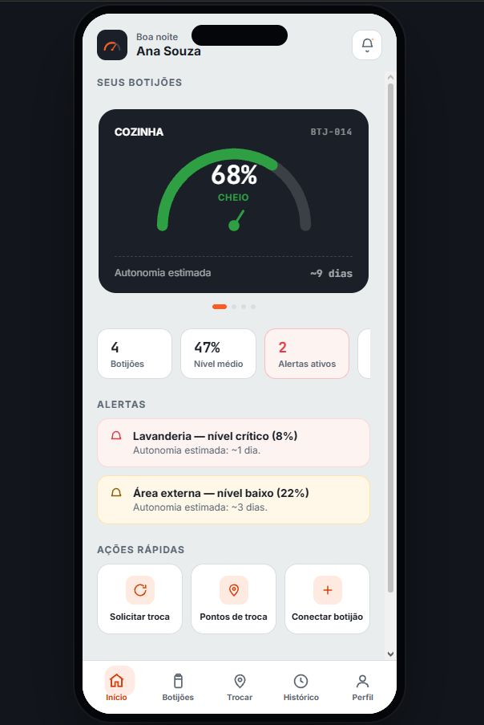
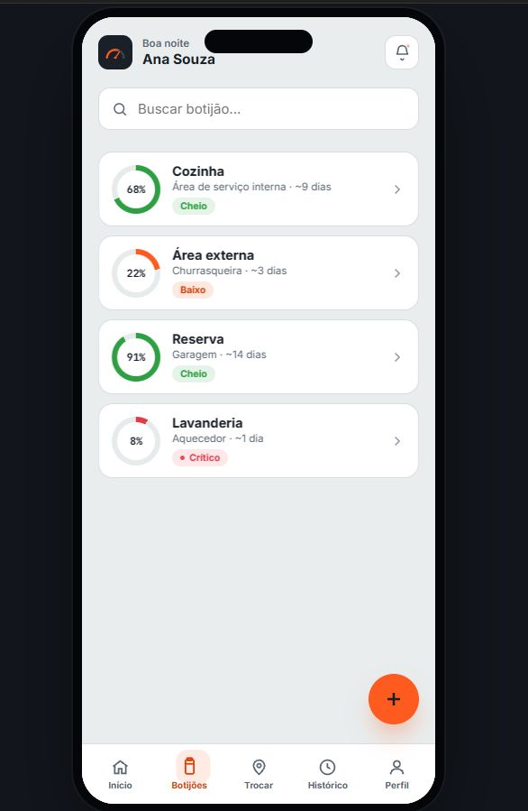
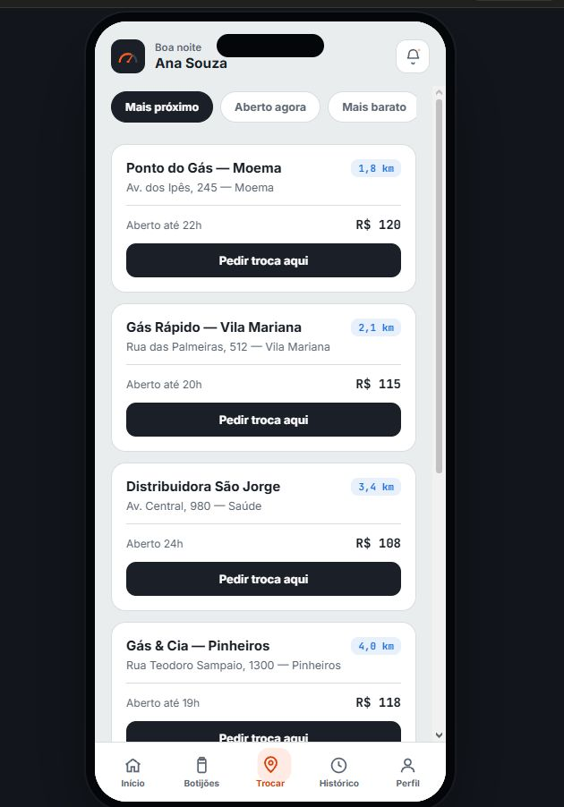
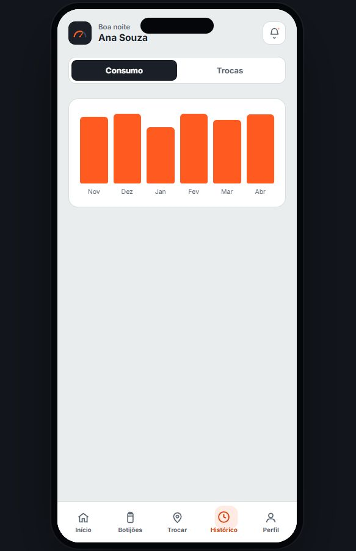

# App Gasômetro

Aplicativo mobile para **monitorar o nível dos botijões de gás** de uma casa, receber alertas
de nível baixo/crítico e **pedir a troca** em pontos de distribuição próximos.

> Status: 🚧 planejamento. Este repositório reúne os mockups e a especificação das telas.
> O código do app entra na pasta `app/` assim que o stack for escolhido.

## Telas (mockup)

| Início | Botijões | Trocar | Histórico |
|---|---|---|---|
|  |  |  |  |

A barra inferior tem 5 abas: **Início, Botijões, Trocar, Histórico e Perfil**.
A tela de Perfil ainda não tem mockup.

## Documentação

- [`docs/telas.md`](docs/telas.md): o que cada tela mostra e faz
- [`docs/design-system.md`](docs/design-system.md): cores, tipografia e componentes
- [`docs/modelo-de-dados.md`](docs/modelo-de-dados.md): entidades iniciais
- [`docs/roadmap.md`](docs/roadmap.md): etapas de desenvolvimento

## Decisões em aberto

- Stack do app (React Native/Expo, Flutter, Kotlin, etc.)
- Origem do nível do botijão: sensor conectado ("Conectar botijão") ou informado manualmente?
- Backend e autenticação
- Fonte dos pontos de troca (cadastro próprio ou API externa)

## Estrutura

```
app-gasometro/
├── README.md
├── docs/
│   ├── mockups/        # imagens das telas
│   ├── telas.md
│   ├── design-system.md
│   ├── modelo-de-dados.md
│   └── roadmap.md
└── app/                # (a criar) código do aplicativo
```
